  

  

<h1 align="center">Hey 👋 What's Up? I'm Ahmed</h1>

  Reverse engineer & malware analysis student, tearing binaries apart in C, C++ and C#. 
  Currently going deeper into <b>.NET</b>.

---

  

  
  

---

## 🧠 What I Do

| Area | Focus |
|------|-------|
| 🔍 **Reverse Engineering** | Disassembly, debugging, static and dynamic analysis |
| 🦠 **Malware Analysis** | Behavior analysis, unpacking, understanding how samples work |
| ⚙️ **C / C++** | Memory, pointers, and how the compiler shapes the binary |
| 🟣 **C# / .NET** | Writing C# daily, learning .NET internals |

## 🌱 Currently Learning

- **.NET internals** (assemblies, IL, how managed code runs)

---

## 📊 GitHub Stats

  

  

## 🐍 Contribution Snake

  

---

  
  

